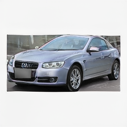
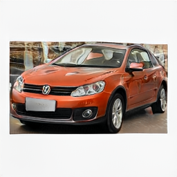

# Car Design Assistant

**Chongqing University · Student Research Training Program (SRTP) · 2026**

A vehicle image generation prototype built with **StyleGAN2-ADA**, three separately fine-tuned models, and a **Windows desktop application**.

**Status:** Final defense completed and project concluded at Chongqing University in **July 2026**.

**3 vehicle models · 16,900 training images · 256 × 256 output**

[中文说明](README.zh-CN.md) · [Project background](#project-background) · [Gallery](#gallery) · [Run guide](docs/reproduction.md) · [Windows release](https://github.com/jinglangqiu-hub/car-design-assistant-srtp/releases/tag/v1.0.0)

## Project background

This repository documents my participation in **Chongqing University's Student Research Training Program (SRTP)** through the project **“基于生成对抗网络的汽车造型设计辅助系统的开发”** (development of a GAN-based assistance system for vehicle styling). The final defense was completed and the project concluded at Chongqing University in July 2026.

As one of my earliest experiences with deep learning, the project explored a complete workflow: preparing vehicle images, adapting an existing generative model, running cloud training, and integrating the resulting models into a desktop application. Its contribution is an educational implementation and integration of existing methods; it does not introduce a new GAN architecture.

## Gallery

| Sports model · seed `796724` | Sports model · seed `437112` |
|:---:|:---:|
|  |  |

Original desktop outputs archived on **June 1, 2026**, at **256 × 256** with **truncation ψ = 0.65**. The model label records the selected checkpoint, not a verified vehicle classification. These examples show recognizable vehicle structure alongside limitations in category control and fine detail. [Original files and generation parameters](assets/README.md).

<details>
<summary>Gallery coverage</summary>

The current repository and sample archive contain these two sports-model outputs. Sedan/SUV examples, a GUI screenshot, and a recorded demonstration are not included. The images are selected illustrations, not a representative evaluation of the three models. Original images and metadata are preserved without retouching.

</details>

## Implementation

| Stage | Work completed | Source and records |
|---|---|---|
| Data preparation | Filter CompCars views, crop vehicle bounding boxes, pad/resize to 256 × 256, and group images into three project categories | [Preparation scripts](experiments/) · [Dataset builder](scripts/build_type_dataset_zips.py) · [Category mapping](configs/srtp_type_mapping.json) |
| Model adaptation | Fine-tune three separate StyleGAN2-ADA models from a shared local car baseline, then continue training each model | [Training scripts](scripts/) · [Training manifest](ppt_materials/03_training_records/manifest.txt) |
| Desktop application | Select a model, set seed and truncation, generate individual/batch images, save PNGs, and record parameters in CSV | [Tkinter application](app/car_design_assistant.py) |
| Windows delivery | Package the application with PyInstaller and create a split installer with Inno Setup | [Build script](scripts/build_pyinstaller_app.ps1) · [Installer configuration](packaging/CarDesignAssistant.iss) · [v1.0.0](https://github.com/jinglangqiu-hub/car-design-assistant-srtp/releases/tag/v1.0.0) |

### Recorded data and training settings

| Project category | Training images | Initial fine-tuning | Additional training | Weight file |
|---|---:|---:|---:|---|
| Sports | 1,519 | 800 kimg | +1,000 kimg | `sports.pkl` |
| Sedan | 5,492 | 1,000 kimg | +1,500 kimg | `sedan.pkl` |
| SUV | 9,889 | 1,000 kimg | +1,500 kimg | `suv.pkl` |

Counts and stages come from the project archive. **kimg** measures thousands of training images shown to the discriminator, including repeated exposure. Category names reflect the project's custom CompCars grouping. The recorded cloud environment was **Ubuntu 22.04, RTX 5090 32 GB, Python 3.12.3, and PyTorch 2.7.0+cu128**, with batch size 16. [Experiment settings and evidence](docs/experiments.md).

Three independent models made vehicle selection straightforward while requiring few changes to the existing framework. The tradeoffs are separate training runs, three weight files, and no shared conditional model. Seed and truncation provide sampling controls; the application does not implement text, sketch, or component-level conditioning.

## AI-assisted development

**Generative AI was used extensively for code generation, debugging, and documentation.** My project work centered on carrying out data preparation, environment setup, training, model integration, and software delivery with that assistance. The application and project scripts are presented as an AI-assisted development effort, with the underlying model and third-party code credited to their original authors.

## Results and limitations

The project produced a training-to-desktop workflow, archived model snapshots and generation records, and a Windows release. It also exposed the difference between a working prototype and a controlled research evaluation:

- **Evaluation:** category training used `--metrics=none`. No verified FID/KID results, controlled baseline comparisons, ablations, or repeated-run evaluations are reported. Longer training is not treated as evidence of better quality.
- **Image quality:** assessment was visual. Diversity, generalization, and memorization were not systematically evaluated; category control and fine detail remain limited.
- **Intended output:** the system produces 256 × 256 raster concepts, not CAD models or engineering-ready vehicle designs.
- **Reproducibility:** the shared `baseline_240` checkpoint, its complete provenance, and a full environment lockfile are not included. Exact reproduction of the historical training is therefore not established.

The main learning outcome was connecting data preparation, model training, inference, and packaging, while recognizing the need to plan provenance, reproducibility, and quantitative evaluation from the outset.

## Run and explore

| Goal | Entry point |
|---|---|
| Use the Windows application | [v1.0.0 assets](https://github.com/jinglangqiu-hub/car-design-assistant-srtp/releases/tag/v1.0.0): download the `.exe` and all three `.bin` parts into the same folder |
| Run or inspect the source | [Setup guide](docs/reproduction.md): configure Python and place trusted weights in `app/models/` |
| Inspect the experiment record | [Training documentation](docs/experiments.md): data mapping, settings, manifest, and reproduction gaps |
| Read the SRTP materials | [Document index](docs/README.md): reports, defense slides, and historical records |

From a configured environment at the repository root:

```powershell
python app\car_design_assistant.py
```

Model weights and training datasets are not included in a clone. The three processed CompCars dataset ZIPs were removed from the release on **November 2, 2026**; obtain data through the [official CompCars process](https://mmlab.ie.cuhk.edu.hk/datasets/comp_cars/). Only load trusted `.pkl` files. [Detailed run instructions](docs/reproduction.md).

## References and acknowledgments

The project builds on the work of the following authors and maintainers:

1. **StyleGAN2-ADA — core training and inference.** Tero Karras, Miika Aittala, Janne Hellsten, Samuli Laine, Jaakko Lehtinen, and Timo Aila. *Training Generative Adversarial Networks with Limited Data.* NeurIPS, 2020. [Paper](https://arxiv.org/abs/2006.06676) · [Official PyTorch implementation](https://github.com/NVlabs/stylegan2-ada-pytorch).
2. **StyleGAN2 — model architecture.** Tero Karras, Samuli Laine, Miika Aittala, Janne Hellsten, Jaakko Lehtinen, and Timo Aila. *Analyzing and Improving the Image Quality of StyleGAN.* CVPR, 2020. [Paper](https://arxiv.org/abs/1912.04958).
3. **CompCars — training data.** Linjie Yang, Ping Luo, Chen Change Loy, and Xiaoou Tang. *A Large-Scale Car Dataset for Fine-Grained Categorization and Verification.* CVPR, 2015. [Dataset and access terms](https://mmlab.ie.cuhk.edu.hk/datasets/comp_cars/) · [Extended paper](https://arxiv.org/abs/1506.08959).
4. **SeFa — reference code.** Yujun Shen and Bolei Zhou. *Closed-Form Factorization of Latent Semantics in GANs.* CVPR, 2021. [Paper](https://arxiv.org/abs/2007.06600) · [Code](https://github.com/genforce/sefa). Retained for reference; SeFa is not used in the final desktop inference path.

[Source provenance and bibliography](docs/references.md) · [BibTeX](references.bib) · [Software and asset license inventory](THIRD_PARTY_NOTICES.md).

## Licensing

| Material | Applicable terms |
|---|---|
| Vendored StyleGAN2-ADA code and its modifications | [NVIDIA Source Code License](refs/stylegan2-ada-pytorch/LICENSE.txt), including its non-commercial research/evaluation restriction |
| SeFa reference code and nested assets | [SeFa MIT license](refs/sefa/LICENSE), with separately identified asset terms in the [inventory](THIRD_PARTY_NOTICES.md) |
| CompCars images and processed training subsets | [Official dataset terms](https://mmlab.ie.cuhk.edu.hk/datasets/comp_cars/); training ZIPs are no longer distributed. Embedded report illustrations are covered by the [asset notices](THIRD_PARTY_NOTICES.md) |
| Project-specific code, documentation, weights, and outputs | No additional blanket reuse license is granted by this repository; see [LICENSE](LICENSE) and [scope/remaining provenance gaps](THIRD_PARTY_NOTICES.md#provenance-gaps) |

Third-party permissions remain with their respective authors and rights holders. The repository's public availability is not a project-wide MIT grant or proof of unrestricted rights to redistribute the weights or historical installer.
