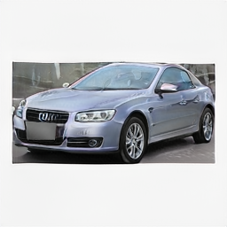
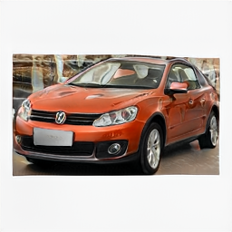

# 汽车外观设计辅助系统

**重庆大学 SRTP · AI 辅助的本科早期科研与工程尝试 · 2026**

[English](README.md) · [运行与复现说明](docs/reproduction.md) · [训练记录](docs/experiments.md)

本项目为完成重庆大学大学生科研训练计划（SRTP）“基于生成对抗网络的汽车造型设计辅助系统的开发”而开展。使用 NVIDIA 已有的 StyleGAN2-ADA 实现，整理汽车图片、微调三类模型，并集成为 Windows 桌面生成程序。

这是我最早期接触深度学习的一次尝试。代码编写、调试和文档整理广泛使用了生成式 AI，不能将仓库中的代码等同于完全独立编写的成果；也没有记录可靠的逐行人类/AI 贡献比例。我的项目实践主要围绕数据准备、执行训练、环境配置、模型集成和软件交付展开。**项目不提出新模型，也不声称改进了 StyleGAN2-ADA。**

## 真实生成样例

| 跑车 · seed 796724 | 跑车 · seed 437112 |
|:---:|:---:|
|  |  |

两张图均为 2026 年 6 月 1 日归档的真实桌面端输出，原始分辨率 256 × 256，truncation ψ = 0.65。“跑车”指所选模型标签，样例并不稳定呈现跑车比例，也体现了车型控制能力有限。细节仍有缺陷，选出的样例不代表平均质量。Release 样例 ZIP 也只有这两张图，目前没有可展示的轿车/SUV 样例、GUI 截图或演示视频。[图片来源](assets/README.md)。

## 具体做了什么

1. **数据整理：** 基于 CompCars 筛选视角、按标注框裁剪、补方并缩放到 256 × 256，按项目映射整理三类数据集。
2. **模型微调：** 从共同的汽车 baseline 出发，分别训练跑车、轿车、SUV 模型，再进行追加训练。
3. **桌面集成：** 使用 Tkinter，根据车型加载对应模型，提供 seed、truncation、批量生成、PNG 保存与 CSV 参数记录。
4. **软件交付：** 使用 PyInstaller 与 Inno Setup 制作 Windows 分卷安装包，并归档代码、训练记录与结项材料。

| 项目类别 | 图片数 | 第一阶段微调 | 追加阶段 | 权重 |
|---|---:|---:|---:|---|
| 跑车 | 1,519 | 800 kimg | +1,000 kimg | `sports.pkl` |
| 轿车 | 5,492 | 1,000 kimg | +1,500 kimg | `sedan.pkl` |
| SUV | 9,889 | 1,000 kimg | +1,500 kimg | `suv.pkl` |

数值来自现有摘要与 manifest，此次未重新训练。1 kimg 表示向判别器展示 1,000 张训练图片，不代表不同图片数量。车型名称对应项目自己的标签归组，不应当成严格的汽车分类体系。

历史云端环境为 Ubuntu 22.04、RTX 5090 32 GB、Python 3.12.3、PyTorch 2.7.0+cu128，batch size 16。具体依据见[实验说明](docs/experiments.md)。

## 技术选择与局限

三个独立模型能少改动现有框架并直接实现车型选择，代价是三个权重文件、独立训练与维护，没有实现单一条件模型。256 × 256 降低了训练和交付成本，也限制了细节质量。

- 三类训练脚本关闭指标计算，没有可核验的 FID/KID 结果；旧通用脚本虽请求计算 FID，也没有对应的有效评价结果。
- 没有严格 baseline 对比、消融或多次重复实验，不能证明追加训练带来了定量改进。
- 主要依靠人工查看样例，没有系统评价多样性、泛化与训练图像记忆情况。
- 只能选择车型、seed 和 truncation，没有文本、草图、零件或几何约束控制；结果不是 CAD 或工程级汽车设计。
- 没有完整环境锁文件，Git 中缺少共同的 `baseline_240` 权重，不能承诺从空环境精确复现历史训练。

这次经历的主要收获是跑通从数据到交付的流程，同时意识到：规范的研究结论还需要数据溯源、完整环境记录、定量评价和受控实验。

## 运行与资料

克隆后另行获取可信模型，放入 `app/models/`，配置兼容环境后运行：

```powershell
python app\car_design_assistant.py
```

详细步骤与安装包组成见[运行说明](docs/reproduction.md)。结项报告、PPT 和历史记录保留原位置，通过[文档索引](docs/README.md)查找；早期计划不代表最终已完成功能。

## 来源与授权

模型来自 [NVIDIA StyleGAN2-ADA](https://github.com/NVlabs/stylegan2-ada-pytorch)，数据来自 [CompCars](https://mmlab.ie.cuhk.edu.hk/datasets/comp_cars/)。`refs/sefa/` 为参考代码，未用于最终桌面推理主线。完整论文引用列在[英文主页](README.md#references--permissions)。

仓库没有统一 MIT 授权。第三方代码保留各自原许可，项目自有部分没有新增宽泛授权，详见 [LICENSE](LICENSE) 与 [THIRD_PARTY_NOTICES.md](THIRD_PARTY_NOTICES.md)。CompCars 原始/处理后训练图片应通过官方流程获取，不应公开再分发；历史 Release 中的模型与安装包也不等于获得了自由再分发或商用许可。
